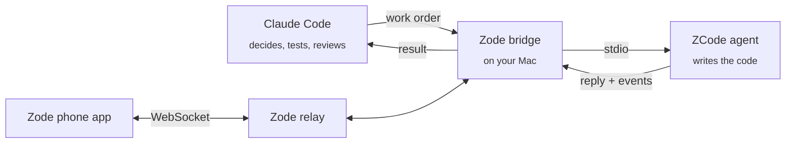
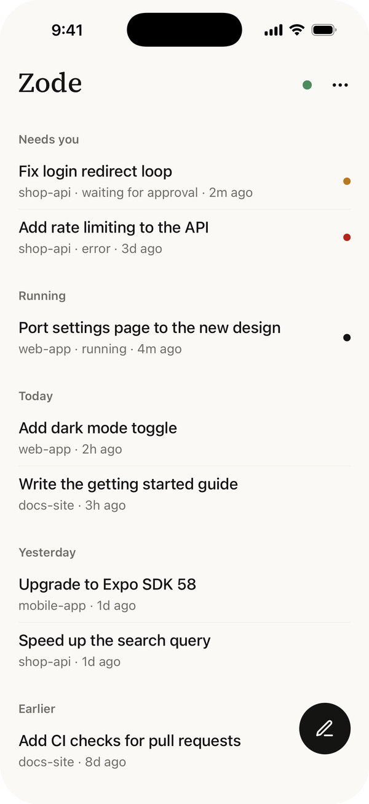
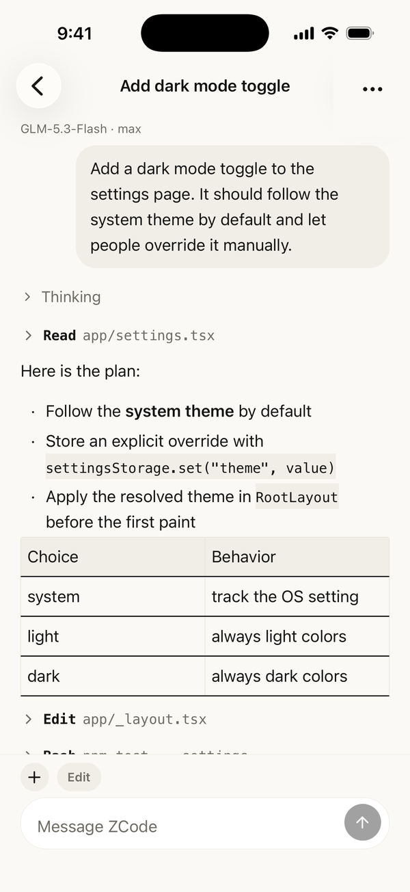
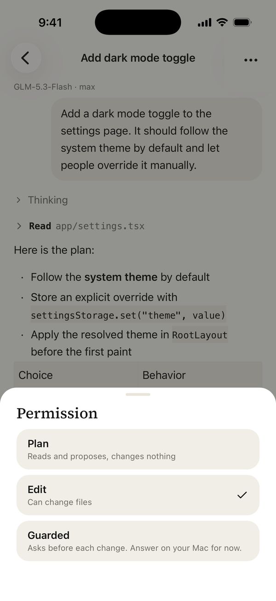

<p align="center">
  
</p>

<h1 align="center">Zode</h1>

<p align="center">
  <b>Claude Code decides. ZCode writes. You watch from your phone.</b><br>
  An autonomous coding loop for macOS, with a pocket-sized remote control.
</p>

<p align="center">
  <a href="LICENSE"></a>
  
  
  
</p>

<p align="center">
  <b>English</b> · <a href="README.zh-CN.md">简体中文</a>
</p>

<p align="center">
  
</p>

---

## What is Zode?

You pay for a coding plan on [ZCode](https://z.ai). You also use [Claude Code](https://claude.com/claude-code).
Zode connects them, so the two do the jobs they are best at:

- **Claude Code** plans the work, writes the work order, runs the tests and reviews the diff.
- **ZCode** (GLM) writes the code, inside a safe git worktree.
- **You** can follow every session, and answer questions, from your phone.

No copy and paste. No API key. Zode drives the ZCode app you already have, with your own login.

## Why you might want it

| Without Zode | With Zode |
|---|---|
| You paste instructions into ZCode, then paste the answer back. | Claude Code sends the order and reads the reply by itself. |
| You read every diff yourself. | Claude Code runs the tests, sends errors back, and reviews. |
| You sit at the Mac while the agent works. | You check progress from the sofa. |

## Quick start

You need: a Mac (Apple silicon), the [ZCode](https://zcode.z.ai) app (logged in at least once), and the Zode app on your iPhone or Android phone.

1. **Download Zode for Mac** from the [latest release](https://github.com/zrll2/zode/releases/latest), open the DMG and drag **Zode** to Applications.
2. Open Zode. A **Z** appears in the menu bar and a short setup window walks you through it: Zode makes its own copy of ZCode (your original is never changed), you sign in once, and then you scan a QR code with Zode on your phone. No terminal needed.
3. Keep the Mac awake. The Mac listens on your Wi-Fi and Tailscale at once, and the phone uses whichever works (use [Tailscale](https://tailscale.com) away from home). Zode can keep the Mac awake for you.

Zode updates itself, and tells you when a new ZCode is available and updates that too.

### Delegate work from Claude Code (optional, for developers)

Zode also lets **Claude Code** hand coding work to ZCode. This part needs Node.js 20 or newer, Git and a terminal:

```bash
git clone https://github.com/zrll2/zode.git && cd zode
./zode skill          # installs the delegate-to-zcode skill for Claude Code
./zode doctor         # everything green?
```

Then, in any project, say to Claude Code:

> **Delegate this to ZCode:** add a dark mode toggle to the settings page.

Claude Code creates a worktree, writes the order, sends it to ZCode, checks the result and shows you the diff.

## How it works



1. You ask Claude Code for a change.
2. Claude Code makes a git worktree on a `zcode/*` branch and writes a **work order** (a Markdown file).
3. The bridge sends the order to ZCode and waits for the answer.
4. Claude Code runs install, type check, tests and the app. Errors go back to ZCode, word for word.
5. Claude Code reviews the diff and commits. You decide whether to merge.

## What is inside

| Folder | What it is |
|---|---|
| [`bridge/`](bridge) | The MCP server and command line tools that drive ZCode. |
| [`skill/`](skill) | The `delegate-to-zcode` skill: the whole workflow, learned the hard way. |
| [`mac/`](mac) | **Zode for Mac**: the Electron menu bar app that runs the relay, pairing and setup. |
| [`macapp/`](macapp) | The older patched-ZCode integration; the builder still uses it for the Engine copy. |
| [`relay/`](relay) | A small WebSocket gateway so your phone can reach your Mac safely. |
| [`app/`](app) | The mobile app (Expo, React Native) for iOS and Android. |
| [`docs/`](docs) | Setup, architecture, protocol and security notes. |

## The phone app

<p align="center">
  
  &nbsp;
  
  &nbsp;
  
</p>

- **Home:** one card per project with a status light. **Needs you** first, then **Running**, then history by day. Archive a conversation with a swipe. Finished `#` work orders are hidden until you turn them on.
- **Chat:** read the agent like a document: Markdown, and tool calls and thinking collapsed to one line.
- **Controls:** rename a chat, switch model and thinking level, and see usage (this chat's context and your account's tokens).
- **Attach:** send photos, camera shots and documents (up to 8 MB each) with the **+** button.
- **Permission level:** switch between Plan, Edit and Guarded from the chat. In Guarded, permission requests can be answered right on the phone; questions that need a typed answer are answered on the Mac.
- Light and dark, black and white, nothing loud.

## Safe by default

- ZCode only works in a **separate git worktree** on a `zcode/*` branch. It never touches `main`.
- ZCode **writes files only**. Claude Code runs every command.
- The phone can use `plan`, `edit` and `guarded` modes only. `yolo` and `build` are blocked in the relay.
- Phones pair with a one-time code and get their own revocable token.
- The terminal relay listens on `127.0.0.1` by default; the Mac app's Automatic mode listens on your Wi-Fi and Tailscale addresses, never `0.0.0.0` (we suggest Tailscale away from home).
- Zode never reads or copies your ZCode credentials.

Read [docs/SECURITY.md](docs/SECURITY.md) before you expose the relay beyond your own machine.

## FAQ

**Is this an official ZCode project?** No. Zode is independent and not affiliated with Z.AI. It talks to your local ZCode app the same way the app talks to its own agent.

**Do I need an API key?** No. Zode uses the login of your ZCode app.

**Why does Zode.app exist?** ZCode keeps your login inside the app, so another program cannot reuse it. The copy adds a tiny shim that shares the app's own agent over a local socket. It is built from your own installation, on your own Mac. Your original app is not changed.

**Windows or Linux?** Not yet. Zode is built and tested on macOS.

**What happens when ZCode updates?** Nothing manual: within about 6 hours of a release, the Zode menu bar shows **ZCode x.y.z is available. Update ZCode and rebuild Zode…** — click it, confirm, and Zode quits, updates the original ZCode, rebuilds itself and reopens (or run `./zode update-zcode` in a terminal). The old manual way, `./zode install`, still works.

## Documentation

[Setup](docs/SETUP.md) · [Workflow](docs/WORKFLOW.md) · [Phone and remote access](docs/PHONE.md) · [Architecture](docs/ARCHITECTURE.md) · [Protocol notes](docs/PROTOCOL.md) · [App Store and Google Play](docs/STORE_SUBMISSION.md) · [Privacy](docs/PRIVACY.md) · [Security](docs/SECURITY.md) · [Contributing](CONTRIBUTING.md)

## License

[MIT](LICENSE). ZCode and Claude Code are trademarks of their owners. Zode contains no code from either product.
