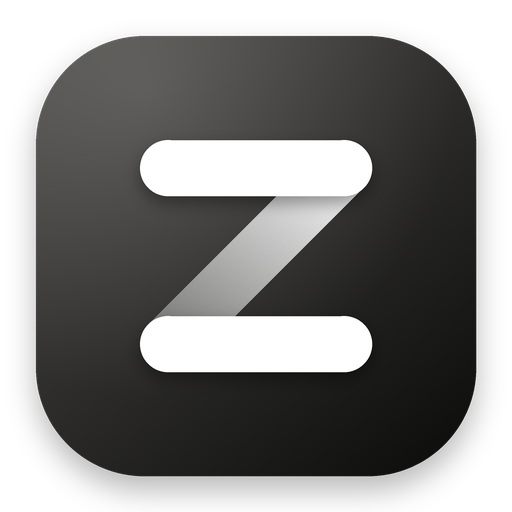
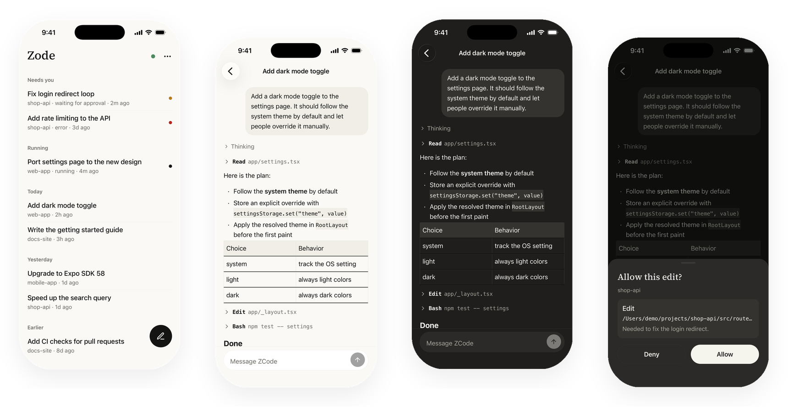
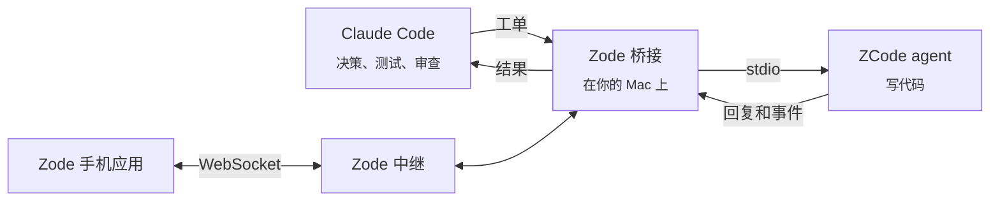

<p align="center">
  
</p>

<h1 align="center">Zode</h1>

<p align="center">
  <b>Claude Code 做决策，ZCode 写代码，你在手机上看进度。</b><br>
  一个 macOS 上的自主编码闭环，外加口袋里的遥控器。
</p>

<p align="center">
  <a href="README.md">English</a> · <b>简体中文</b>
</p>

<p align="center">
  
</p>

---

## Zode 是什么？

你在 [ZCode](https://z.ai) 买了编码套餐，也在用 [Claude Code](https://claude.com/claude-code)。
Zode 把两者连起来，让它们各做自己最擅长的事：

- **Claude Code**：规划任务、写工单、跑测试、审查 diff。
- **ZCode**（GLM）：在独立的 git worktree 里写代码。
- **你**：在手机上看每个会话的进度，并回答问题。

不用复制粘贴，不用 API Key。Zode 直接驱动你已经装好的 ZCode 应用，用你自己的登录。

## 为什么需要它

| 没有 Zode | 有 Zode |
|---|---|
| 你把指令粘贴给 ZCode，再把回复粘贴回来。 | Claude Code 自己发工单、自己读回复。 |
| 每个 diff 都要自己看。 | Claude Code 跑测试，把错误原样发回，并审查。 |
| Agent 干活时你得守在电脑前。 | 你在沙发上就能看进度。 |

## 快速开始

需要：一台 Mac、已登录的 [ZCode](https://z.ai)、[Claude Code](https://claude.com/claude-code)、Node.js 20+、Git。

```bash
git clone https://github.com/zrll2/zode.git && cd zode
./zode install        # 基于你的 ZCode 构建 "Zode.app" 副本，并安装技能
open ~/Applications/Zode.app   # 登录一次，打开任意项目
./zode doctor         # 全部通过了吗？
```

然后在任何项目里对 Claude Code 说：

> **把这个交给 ZCode：** 给设置页加一个深色模式开关。

就这样。Claude Code 会建 worktree、写工单、发给 ZCode、检查结果，并把 diff 给你看。

### 加上手机应用（可选）

```bash
./zode relay          # 在 Mac 上启动中继
./zode pair           # 打印二维码
```

打开 Zode 应用，点 **Scan QR code**。完成。出门在外怎么连回家里的 Mac，见 [docs/PHONE.md](docs/PHONE.md)。

## 工作原理



1. 你向 Claude Code 提出修改需求。
2. Claude Code 在 `zcode/*` 分支上建 git worktree，写一份 **工单**（Markdown 文件）。
3. 桥接把工单发给 ZCode，等待回复。
4. Claude Code 运行安装、类型检查、测试和应用本身。错误一字不改地发回 ZCode。
5. Claude Code 审查 diff 并提交。是否合并由你决定。

## 仓库内容

| 目录 | 说明 |
|---|---|
| [`bridge/`](bridge) | 驱动 ZCode 的 MCP 服务和命令行工具。 |
| [`skill/`](skill) | `delegate-to-zcode` 技能：整个工作流，都是踩坑换来的。 |
| [`relay/`](relay) | 小型 WebSocket 网关，让手机安全地连到你的 Mac。 |
| [`app/`](app) | 手机应用（Expo、React Native），iOS 和 Android。 |
| [`docs/`](docs) | 安装、架构、协议和安全说明。 |

## 默认安全

- ZCode 只在 **独立的 git worktree**、`zcode/*` 分支里工作，从不碰 `main`。
- ZCode **只写文件**，所有命令由 Claude Code 运行。
- 手机只能用 `plan` 和 `edit` 模式，中继会拦截 `yolo` 和 `build`。
- 手机用一次性配对码配对，各自拥有可撤销的令牌。
- 中继默认只监听 `127.0.0.1`，除非你选择私有网络地址（推荐 Tailscale）。
- Zode 从不读取或复制你的 ZCode 凭据。

把中继暴露到本机之外之前，请先读 [docs/SECURITY.md](docs/SECURITY.md)。

## 常见问题

**这是 ZCode 官方项目吗？** 不是。Zode 是独立项目，与 Z.AI 无关。它与你本机的 ZCode 应用沟通的方式，和应用与自己的 agent 沟通的方式相同。

**需要 API Key 吗？** 不需要。Zode 用的是 ZCode 应用里的登录。

**为什么需要 Zode.app（ZCode 的副本）？** ZCode 把登录保存在应用内部，别的程序无法复用。副本里只多一个很小的垫片文件，用本地套接字共享应用自己的 agent。副本由你自己的安装在你自己的 Mac 上构建，原应用不会被改动。

**支持 Windows 或 Linux 吗？** 暂时不支持，目前只在 macOS 上构建和测试。

**ZCode 更新后怎么办？** 重新运行 `./zode install` 即可。

## 文档

[安装](docs/SETUP.md) · [工作流](docs/WORKFLOW.md) · [手机与远程访问](docs/PHONE.md) · [架构](docs/ARCHITECTURE.md) · [协议笔记](docs/PROTOCOL.md) · [上架 App Store 和 Google Play](docs/STORE_SUBMISSION.md) · [隐私](docs/PRIVACY.md) · [安全](docs/SECURITY.md) · [参与贡献](CONTRIBUTING.md)

## 许可证

[MIT](LICENSE)。ZCode 和 Claude Code 是各自所有者的商标。Zode 不包含这两个产品的任何代码。
