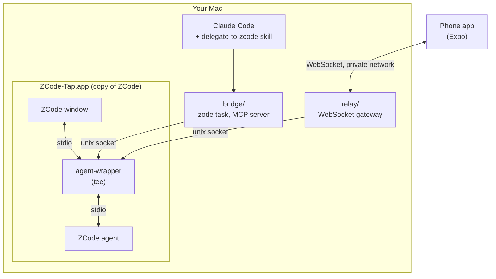

# Architecture

Zode has four small parts. Each does one job.

## The parts

**ZCode agent.** ZCode runs its agent as a child process and talks to it over stdio with newline-delimited JSON (the "app-server" protocol). Sessions are stored in `~/.zcode`. See [PROTOCOL.md](PROTOCOL.md).

**agent-wrapper (the tee).** Sits between the ZCode window and the agent. It forwards every line both ways, unchanged, so ZCode works as before. It also listens on a unix socket in `~/.zcode-tap/` and lets other clients (the bridge and the relay) send requests to the same agent and receive a copy of every event. Rules:

- Requests from other clients get a private id (`tap:<n>:<id>`) so they never clash with the window's ids. Replies go back only to the client that asked.
- Permission and user-input requests that the agent sends to the window are tracked. The **first answer wins**, from the window or from another client. The late answer is dropped, and every client is told (`tap/resolved`).
- A tap failure never breaks ZCode: the socket is optional.

**bridge.** `zcode-task.mjs` sends one work order and waits for the turn to end. `server.mjs` is an MCP server with the same abilities as tools. `doctor.mjs` checks the setup. `zcode-stop.mjs` stops a turn.

**relay.** Accepts phones over WebSocket, checks their token, allows only a short list of session methods, forwards them to the tap socket, and streams events back. It keeps the last 5000 events so a phone can reconnect and catch up. It keeps every frame under 800 KB because iOS closes a WebSocket on a frame above 1 MiB (for example, it drops the message list from `session/resume`, which the phone loads separately).

**app.** An Expo app. A small client (`src/relay/client.ts`) handles pairing, authentication, request matching, reconnect and replay. A reducer (`src/relay/reducer.ts`) turns events into chat items. Screens follow [`app/docs/DESIGN.md`](../app/docs/DESIGN.md).

**ZCode-Tap.** Built by `scripts/build-tap.sh`: copy the app, move `glm/zcode.cjs` to `glm/zcode.real.cjs`, add a shim as `zcode.cjs`, sign ad hoc. The shim loads the wrapper from the Zode folder (path in `~/.zode/home`).

## Why this design

- **No API key.** The login stays inside the ZCode app. Zode only shares the agent the app already started.
- **Nothing proprietary is shipped.** The tap copy is built locally from the user's own app.
- **Small surface.** The relay allows 16 session methods and two safe modes. Everything else is refused.
- **Claude Code does the verification.** ZCode in `edit` mode cannot run commands, so a human-like checker (Claude Code) runs tests and the app. This is what makes the loop trustworthy.
